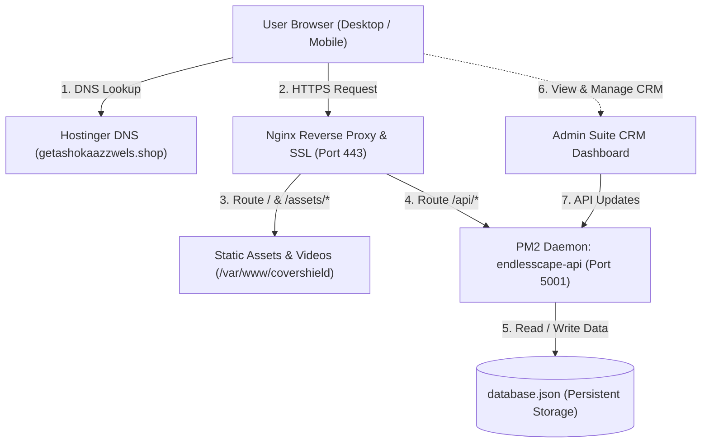

# Architecture Overview & Data Flow

This document provides a bird's-eye architectural view of the entire **Endlesscape** ecosystem, illustrating client-server interactions, reverse-proxy routing, and production infrastructure.

---

## ✦ High-Level Topology

---

## ✦ Network & Traffic Flow

1. **Client DNS Resolution**:
   - The user visits `getashokaazzwels.shop`.
   - Hostinger nameservers resolve the apex domain to `195.35.45.17`.
   - `www` subdomain triggers an immediate 301 canonical redirect to apex.

2. **Edge SSL Termination (Nginx)**:
   - Nginx terminates TLS with a 2048-bit Let's Encrypt certificate.
   - HTTP/2 multiplexing is enabled for instant parallel asset downloads.

3. **Static File & Media Delivery**:
   - SPA route (`/`, `/itineraries`, `/experiences`) falls back to `/var/www/covershield/index.html`.
   - Media streaming (`/assets/videos/hero-desktop.mp4` & `hero-mobile.mp4`) uses `accept-ranges: bytes` allowing smooth seeking with zero buffer stalls.
   - Long-term caching headers (`Cache-Control: public, no-transform; max-age=2592000`) prevent redundant video re-downloads.

4. **REST API Reverse Proxy**:
   - Inbound requests to `/api/*` are forwarded internally to `http://127.0.0.1:5001/api/*`.
   - Client headers (`X-Real-IP`, `X-Forwarded-Proto`, `Host`) are preserved.
   - No CORS errors occur in production because both frontend and backend share the identical origin.

5. **Process Resilience**:
   - If the Node.js server experiences an unhandled exception, PM2 automatically restarts the process in `< 100ms`.
   - `pm2 save` persists the process list across VPS reboots.
